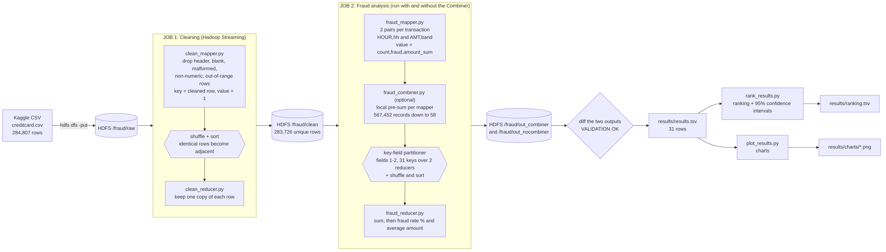

# Large-Scale Financial Fraud Detection with Hadoop MapReduce

A distributed analytics pipeline that ingests ~285,000 credit-card transactions into HDFS,
cleans them, and uses Hadoop Streaming (Python) MapReduce jobs to find where fraud concentrates:
by hour of day and by transaction amount. Includes a Combiner, a key-field partitioner, validation,
and a with/without-Combiner comparison.

## Project structure

```
.
├── README.md
├── run_pipeline.sh        # full pipeline on HDFS: ingest, clean, analyse, validate
├── run_local.sh           # same jobs simulated locally (cat | map | sort | reduce), no Hadoop
├── src/
│   ├── cleaning/          # job 1: clean_mapper.py, clean_reducer.py
│   ├── analysis/          # job 2: fraud_mapper.py, fraud_combiner.py, fraud_reducer.py,
│   │                      #        rank_results.py (ranking + confidence intervals)
│   ├── visualize/         # plot_results.py
│   └── tools/             # gen_synthetic.py (synthetic test data generator)
├── data/                  # creditcard.csv goes here (not in git, see data/README.md)
├── results/
│   ├── results.tsv        # final validated output
│   ├── ranking.tsv        # ranked buckets with 95% confidence intervals
│   ├── charts/            # fraud_by_hour.png, fraud_by_amount.png, combiner_shuffle.png
│   └── validation/        # with-Combiner vs without-Combiner outputs (identical)
├── logs/
│   └── counters_summary.txt   # key Hadoop counters (full run_log.txt stays local)
└── docs/                  # architecture diagram (architecture.png / .mmd) and report
```

## Dataset

| Item | Detail |
|---|---|
| Name | Credit Card Fraud Detection |
| Source | https://www.kaggle.com/datasets/mlg-ulb/creditcardfraud |
| Owner | Worldline and the Machine Learning Group of ULB (Universite Libre de Bruxelles) |
| Licence | Database Contents Licence (DbCL 1.0), as listed on Kaggle |
| Period | September 2013, two days of transactions by European cardholders |
| Size | 284,807 transactions, 492 labelled fraud (0.172%); one CSV of ~150 MB |

The data is **not** included in this repository (it is large and has its own licence terms).
Download `creditcard.csv` from the link above and place it at `data/creditcard.csv`.

Schema:

| Field | Type | Description |
|---|---|---|
| `Time` | float | Seconds elapsed since the first transaction in the dataset |
| `V1`..`V28` | float | Anonymised features (PCA components) |
| `Amount` | float | Transaction amount |
| `Class` | int | 1 = fraud, 0 = genuine |

Citation requested by the dataset owners: Dal Pozzolo, Caelen, Johnson and Bontempi,
*Calibrating Probability with Undersampling for Unbalanced Classification*, IEEE CIDM, 2015.

`src/tools/gen_synthetic.py` generates **synthetic** records in the same schema. They are for
testing the pipeline only and are not real transactions.

## Architecture and dataflow



Text version:

```
data/creditcard.csv
     |  hdfs dfs -put
     v
HDFS /fraud/raw
     |
     v   JOB 1: CLEANING
 clean_mapper.py   - drops header, blank, malformed, non-numeric, out-of-range rows
     |   key = cleaned row, value = 1
     v   shuffle + sort (identical rows become adjacent)
 clean_reducer.py  - keeps one copy of each row (removes duplicates)
     |
     v
HDFS /fraud/clean
     |
     v   JOB 2: ANALYSIS
 fraud_mapper.py   - emits (HOUR,hh) and (AMT,band) with value count,fraud,amount_sum
     |
 fraud_combiner.py - local pre-sum on each mapper's output (optional)
     |
     v   key-field partitioner on fields 1-2 (31 keys spread over 2 reducers)
 fraud_reducer.py  - sums, then computes fraud rate % and average amount
     |
     v
HDFS /fraud/out_combiner       (same job without -combiner -> /fraud/out_nocombiner)
     |
     v
results/results.tsv  ->  plot_results.py  ->  results/charts/*.png
```

## Key-value design

Mapper output of the analysis job (tab separated; key = first two fields):

```
HOUR <TAB> 03 <TAB> 1,1,4.05        # count, fraud_count, amount_sum
AMT  <TAB> 1  <TAB> 1,1,4.05        # amount band 1 = amounts from 1 to under 10
```

Amount bands: 0 = under 1, 1 = 1-10, 2 = 10-50, 3 = 50-100, 4 = 100-500, 5 = 500-1000, 6 = 1000+.
Hour = `(Time // 3600) mod 24`, i.e. hours since the first transaction, **not** real clock time.

Reducer output: `DIMENSION  BUCKET  total_txns  fraud_txns  fraud_rate_pct  avg_amount`.

Hadoop Streaming note: the key is the first N tab-separated fields of a line. The job sets
`stream.num.map.output.key.fields=2` for mapper output and `stream.num.reduce.output.key.fields=2`
for combiner/reducer output; without the second setting the Combiner's output is re-keyed on one
field and the reducer receives wrong groups.

## Requirements

- Hadoop 3.5.x (single-node / pseudo-distributed is enough) with Java 17
- Python 3 (for the streaming scripts); `python3-matplotlib` for the charts

## How to run

```bash
# 1. put creditcard.csv in data/, start HDFS and YARN (start-dfs.sh, start-yarn.sh)
bash run_pipeline.sh                      # also writes logs/run_log.txt
python3 src/visualize/plot_results.py     # charts into results/charts/
python3 src/analysis/rank_results.py      # ranking + confidence intervals -> results/ranking.tsv
```

`run_pipeline.sh` ingests the data, runs both jobs, runs the analysis a second time without the
Combiner, and finishes with an automatic check that both outputs are identical.

Quick local test without Hadoop:

```bash
bash run_local.sh                                              # real data
python3 src/tools/gen_synthetic.py 20000 > data/synthetic.csv
bash run_local.sh data/synthetic.csv                           # synthetic data
```

## Results (from `logs/counters_summary.txt`)

Cleaning job: 284,808 input lines (including the header) -> 284,807 valid rows -> 1,081 duplicates
removed -> **283,726 unique transactions, 473 fraud** (0.167%).

Combiner comparison, analysis job (same output, validated with `diff`):

| Counter | With Combiner | Without Combiner |
|---|---|---|
| Reduce input groups | 31 | 31 |
| Combine output records | 58 | 0 |
| Reduce shuffle bytes | 1,606 | 10,708,562 |
| Wall-clock time | 32.6 s | 29.9 s |

The Combiner reduces the data shuffled between map and reduce by about 6,700 times. Wall-clock time
is essentially unchanged: on a single machine the shuffle is local and only ~10 MB, so job startup
dominates. A time saving would be expected only on larger data or a multi-node cluster.

## Findings

Ranked by fraud rate with 95% Wilson confidence intervals (`results/ranking.tsv`). Overall rate:
0.167%. A bucket is called reliable only if it has at least 20 fraud cases and its whole interval
lies above (or below) the overall rate.

- **Hour of day (hours since the first transaction):** hour 02 is the riskiest, 1.45% fraud
  (48 of 3,308 transactions, 8.7x the average), then hour 04 at 1.04% (23 of 2,204, 6.3x). Hours
  07 and 11 are also reliably above average, but only about 1.9x. Hour 03 and several other
  small hours look high but have fewer than 20 fraud cases, so no conclusion is drawn.
- **Amount:** the smallest payments (under 1) and the 500-1000 band are both reliably about 2.4x
  and 2.3x the average (0.39%). The 1-10 band is slightly above average (1.3x) and holds the
  most fraud cases (172 of 473). The 10-50 band is reliably lower than average (0.06%).
- Both dimensions reconcile: 283,726 transactions and 473 fraud cases each.

## Limitations

- Only two days of data; patterns may not generalise.
- `Time` is relative to the first transaction, so "hour" is not a real clock hour.
- Some hours and bands contain few fraud cases, so their rates are noisy.
- The dataset is heavily imbalanced (0.17% fraud) and its features are PCA-anonymised, so this
  project does counting and aggregation, not a predictive model.
